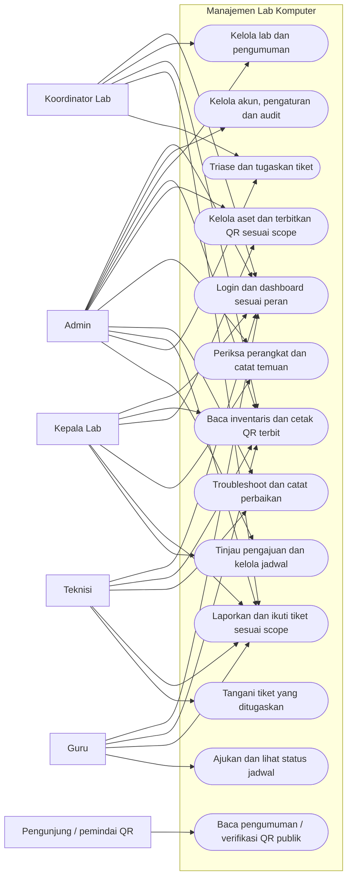
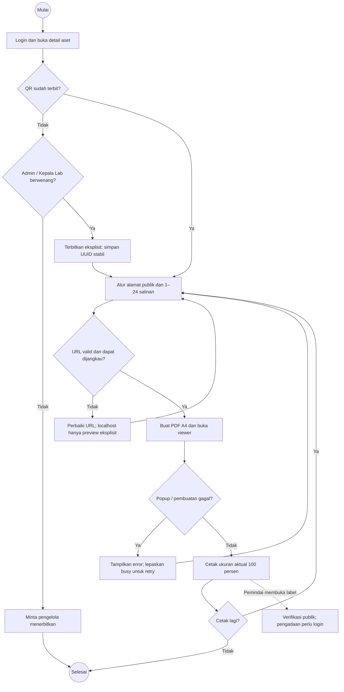

# Sistem Informasi Manajemen Lab Komputer

Aplikasi sekolah berbasis **React 19/Vite, Express 5, MySQL (mysql2 dan Prisma)** untuk laboratorium, inventaris, jadwal, maintenance dan bantuan layanan. Dokumentasi proyek disatukan di README ini. **[openapi.json](openapi.json) di root adalah satu-satunya referensi kontrak API**: operasi, autentikasi, parameter, payload, respons dan error. Impor ke klien OpenAPI; tidak ada Swagger UI baru.

## Fitur dan lima peran

- Dashboard sesuai peran dengan ringkasan, grafik, antrean dan tautan ke data terkait.
- Laboratorium, penanggung jawab, perangkat Pembelajaran, pemeriksaan, temuan, troubleshoot dan riwayat perbaikan.
- **Aset IT Sekolah** untuk inventaris Operasional, termasuk komputer, laptop, monitor, printer, perangkat jaringan dan proyektor. Identitas tetap `perangkat_id`, bukan tabel aset duplikat. Pembelajaran wajib mempunyai lab; Operasional tidak mempunyai lab. Lokasi/pengadaan opsional; harga memakai string desimal, bukan float.
- QR stabil, verifikasi publik dan label PDF berulang. Detail aset dari tiket memakai `/aset-it?asset=<id>`, termasuk aset Pembelajaran yang tidak muncul pada daftar Operasional.
- **Bantuan · Tiket Layanan** (`/ticketing`): insiden/permintaan layanan, klasifikasi dampak–urgensi, prioritas P1–P4, penugasan, komentar, riwayat dan SLA.
- Pengajuan/persetujuan jadwal, pengumuman/lampiran, nama/logo/warna sekolah dan konfigurasi jam pelajaran.
- Navigasi persisten, tabel native dengan scroll lokal, skeleton, error/retry, serta onboarding Driver.js. Panduan otomatis muncul sekali per akun dan menjelaskan semua menu sidebar sesuai peran. Statusnya disimpan di database agar tidak muncul lagi setelah pindah halaman, login ulang, atau menggunakan perangkat lain. Pengguna tetap bisa membuka Panduan awal dari menu profil kapan pun diperlukan.

| Peran | Tanggung jawab dan batas |
| --- | --- |
| **Admin** | Akun, pengaturan, log aktivitas, lab/pengumuman, semua aset, maintenance/jadwal, triase dan penugasan tiket, kebijakan SLA. |
| **Koordinator Lab** | Lab/pengumuman; seluruh tiket, klasifikasi dan penugasan. Aset hanya baca; tidak mengubah kebijakan SLA. |
| **Kepala Lab** | Perangkat Pembelajaran dan penerbitan QR hanya pada lab tanggung jawabnya; pemeriksaan dan pengelolaan pengajuan jadwal. Melihat tiket sendiri atau terkait aset labnya; hak pelapor hanya untuk tiket yang dilaporkannya sendiri. |
| **Teknisi** | Temuan, troubleshoot/perbaikan dan seluruh antrean tiket; mengambil tiket belum ditugaskan dan mengerjakan tiket miliknya, bukan mengambil alih teknisi lain. Aset hanya baca. |
| **Guru** | Ajukan/lihat status jadwal, lihat jadwal, laporkan dan ikuti tiket sendiri. Aset hanya baca. |

Semua peran login dapat membaca inventaris termasuk pengadaan dan mencetak QR yang sudah terbit. Otorisasi backend tetap menentukan izin, bukan sekadar menu tersembunyi. Pengunjung tanpa login hanya memperoleh proyeksi QR/pengumuman publik, bukan dashboard atau pengadaan.

## Setup: tetap gunakan database dan konfigurasi saat ini

Prasyarat: **Node.js >=24**, npm, serta MySQL **yang sudah tersedia dan skemanya kompatibel**. Gunakan konfigurasi lokal yang sudah ada; jangan mengganti target database untuk mengikuti README ini.

Dari root:

```sh
npm ci
npm --prefix frontend ci
npm --prefix backend ci
```

Jalankan pada dua terminal dari root, hanya jika instance aplikasi belum aktif:

```sh
# Terminal backend
cd backend
npm start
```

```sh
# Terminal frontend
cd frontend
npm run dev
```

Backend memakai `PORT` yang dikonfigurasi (fallback 5000); Vite dikonfigurasi pada 5174. Gunakan alamat aktual pada output startup. Ctrl+C hanya untuk server yang Anda jalankan sendiri.

- mysql2 memakai `DB_*`, Prisma memakai `DATABASE_URL`; keduanya harus menunjuk **database yang sama**. Jangan mencetak nilai koneksi, token atau sandi.
- Development memakai proxy Vite same-origin `/api` dan `/uploads`; tujuan mengikuti `VITE_BASE_URL`, `VITE_ASSET_BASE_URL` dan bila diperlukan `VITE_DEV_PROXY_TARGET`. Dari HP satu jaringan, buka IP komputer pada port frontend, bukan localhost HP; akses firewall/jaringan harus diizinkan.
- Production memakai konfigurasi saat build. Siapkan HTTPS, reverse proxy dan SPA fallback agar deep link bekerja. Proxy development bukan konfigurasi deployment.
- Startup tidak otomatis menerapkan migrasi. Bila skema belum siap, minta operator meninjau kompatibilitas/backup **pada database yang sama** sebelum tindakan terpisah; migrasi bertanda review-only bukan bootstrap produksi.
- **Tidak ada create/clone/switch/reset database, seed akun atau penerapan SQL otomatis dalam setup ini.** Jangan menjalankan runner review historis pembuat database baru untuk setup biasa. Tidak ada akun/sandi demo dipublikasikan.

## Struktur dan pengujian

```text
README.md              Dokumentasi proyek tunggal
openapi.json           Referensi API tunggal
frontend/              UI React dan Vite
backend/               Express, router, controller, service, repository, Prisma/migrasi
shared/                Aturan/helper lintas aplikasi
test/
  run.mjs              Runner terpusat
  frontend/            Tes frontend
  backend/             Tes backend
  shared/              Tes helper bersama
  contracts/           Tes kontrak
```

Setelah instalasi root dan kedua aplikasi, jalankan dari root:

```sh
npm test
npm run test:frontend
npm run test:backend
npm run test:shared
npm run test:contracts
npm run lint
npm run build
```

`npm test` memakai `test/run.mjs`; tes proyek terpusat di `test/{frontend,backend,shared,contracts}`, bukan tersebar dalam direktori produksi. Tes dengan boundary sintetis bukan UAT login produksi, persistensi MySQL aktual, kamera HP atau printer fisik. Jalankan suite pada working tree yang akan dirilis; angka tes/review lama bukan hasil revisi saat ini. Pengujian yang menulis database membutuhkan persetujuan terpisah dan bukan bagian setup di atas.

## Use Case Diagram

**Flowchart Mermaid dengan aktor dan use case oval**, bukan renderer UML use-case native. Diagram merangkum interaksi; batas akses tetap mengikuti tabel peran dan backend.



## Activity Diagram

### Aset → QR → cetak ulang



- Penerbitan eksplisit idempoten: mengembalikan UUID yang sama. Edit inventaris/rotasi JWT tidak mengganti QR; penghapusan aset membuat tautan lama tidak ditemukan. Belum ada rotasi/revoke QR. QR menunjuk catatan inventaris, **bukan sertifikat keaslian fisik atau kepemilikan**.
- Publik hanya melihat identitas, spesifikasi, inventaris, kondisi, kategori, penggunaan dan lokasi/lab; bukan foto, pengadaan atau identitas pengguna. Pengadaan diminta terpisah setelah login; pergantian sesi menyembunyikan hasil privat lama.
- Base URL mengikuti frontend/base deployment, opsional `VITE_QR_PUBLIC_ORIGIN` atau alamat publik sekolah. Jangan tempel label localhost. Pertahankan domain/base path setelah label dipasang.
- PDF A4 berisi 10 label 90 × 50 mm per halaman, maksimal 24 salinan per job. Cetak ulang tidak menerbitkan UUID, mengonsumsi label atau mengubah aset. Hanya klik selama job berjalan yang ditekan.
- Setiap Blob URL mengikuti viewer masing-masing, dilepas setelah viewer ditutup, bukan timeout lima menit. Menutup detail tidak menutup viewer. Reload setelah dokumen pembuka dihancurkan tidak dijamin; dialog OS/printer fisik bergantung lingkungan pengguna.

### Tiket layanan dan pengajuan jadwal

Dua alur independen; tiket tidak wajib terkait pengajuan jadwal.

```mermaid
flowchart TD
  subgraph Tiket[Pelapor, pengelola dan teknisi]
    TS((Mulai tiket)) --> CR[Pelapor membuat tiket: new]
    CR --> AS[Ditugaskan / diambil teknisi: assigned]
    AS --> IP[Mulai: in_progress]
    AS --> PE[pending dengan alasan]
    IP --> PE
    PE --> IP
    IP --> LF{Temuan impor belum ditangani?}
    LF -- Ya --> RP[Catat perbaikan berhasil di menu Perbaikan]
    RP --> RE[Resolve disertai solusi: resolved]
    LF -- Tidak --> RE
    RE --> VE{Verifikasi pelapor independen / pengelola}
    VE -- Terima --> CL[closed]
    VE -- Perlu penanganan lagi --> RO[Reopen: assigned atau new]
    CL -- Reopen beralasan --> RO
    RO --> AS
    CR -. Batal sesuai izin .-> CA[cancelled]
    CL --> TE((Selesai tiket))
    CA --> TE
  end
  subgraph Jadwal[Guru, sistem dan pengelola]
    JS((Mulai jadwal)) --> AJ[Guru pilih lab, tanggal dan slot pelajaran]
    AJ --> VA{Input dan slot valid?}
    VA -- Tidak --> AJ
    VA -- Ya --> ME[Pengajuan menunggu peninjauan]
    ME --> AP{Admin / Kepala Lab menyetujui?}
    AP -- Tidak --> RJ[Ditolak; Guru melihat status]
    AP -- Ya --> CF{Masih bebas bentrok?}
    CF -- Tidak --> RJ
    CF -- Ya --> SA[Disetujui; tampil pada jadwal]
    RJ --> JE((Selesai jadwal))
    SA --> JE
  end
```



- Aset pada tiket opsional. Impor temuan dilakukan **eksplisit dan idempoten** oleh Admin/Koordinator/Teknisi; temuan baru tidak otomatis menjadi tiket. Resolve tiket impor ditolak sebelum sumber temuan sudah ditangani. Status perbaikan perangkat dan verifikasi tiket berbeda: menutup tiket tidak menciptakan perbaikan fiktif.
- Pending dari assigned/in_progress, resume ke in_progress. Pelapor/pengelola dapat membatalkan selama belum closed/cancelled sesuai izin. Reopen dari resolved/closed mempertahankan riwayat. Komentar/eskalasi mengikuti scope. Pembaruan memakai `version`; konflik stale/bersamaan menghasilkan 409 dan perlu muat ulang.
- Prioritas dihitung dari dampak dan urgensi. SLA adalah snapshot saat pembuatan, **24×7 elapsed time**: pending tidak menghentikan jam; reopen tidak mereset waktu awal. Kebijakan baru tidak diam-diam menggeser tiket lama. Default contoh respons/resolusi (menit): P1 15/240, P2 60/480, P3 240/1440, P4 480/4320; sekolah harus menyetujui target sendiri.
- Jadwal memakai konfigurasi awal/akhir hari dan durasi pelajaran. Slot berdampingan bukan overlap; persetujuan memeriksa ulang konflik, bukan menimpa jadwal lain. Guru mengikuti hasil melalui status pengajuan.

## Keamanan dan batas operasional

- Hapus dimulai dari preview relasi; backend memeriksa ulang izin/keterkaitan dalam transaksi. Histori pemeriksaan, temuan, perbaikan dan tiket **tidak dihapus otomatis**. Konflik menghasilkan 409; alihkan tanggung jawab/pindahkan aset melalui fitur yang tersedia, bukan menghapus histori agar lolos.
- Kondisi aset: Baik, Rusak, Perlu Perbaikan, Dalam Perbaikan. Perubahan manual ditolak bila ada temuan aktif; selesaikan lewat troubleshoot/perbaikan. Edit metadata tidak menyelesaikan temuan otomatis.
- Log aktivitas hanya Admin, dengan filter pelaku/aksi/tanggal WIB dan pagination. Metadata di-allowlist, bukan body/sandi/token/query mentah. Audit asynchronous best effort: outage, overflow atau crash dapat kehilangan log. Ini bukan durable compliance queue atau audit perubahan tiap field; tetapkan retensi/backup terpisah.
- Logo raster maksimal 2 MiB, validasi tipe/ekstensi/signature, bukan antivirus; SVG/data URL tidak didukung. File upload statis bukan penyimpanan privat hanya karena UI membutuhkan login. Jangan masukkan secret/data pribadi tak perlu ke tiket, lampiran atau log.
- Adaptasi layanan/inspirasi GLPI terbatas: **bukan implementasi penuh GLPI, sertifikasi ISO/IEC 20000-1 atau bukti kepatuhan organisasi**. SOP, pemilik layanan, SLA, kontrol database, backup, retensi dan audit organisasi tetap tanggung jawab sekolah.

## Provenans versi dan risiko historis

- Baseline v1: `92633b3f1780857afe79c9a341f2a2a979cc8536` (`feat(ui): improve UX`), arsip `archive/v1-92633b3`. Ini snapshot Git, bukan rekonstruksi pasti perubahan lama yang belum di-commit.
- Target **`v1.0.0` tersanitasi** yang disetujui: **`6cbd6d170f2d9e2cc9af9425d680cf4c14e125c3`**; annotated tag object `f05e6920886079a933dbcb54e31542c67de4961f`. Catatan terdahulu melaporkan remote tag/target sudah dibaca balik; konsolidasi ini tidak memverifikasi remote ulang.
- Snapshot parentless mempertahankan 123 blob source asli identik. **Pengecualian sanitasi**: environment privat dan dua dump SQL berisi akun dikecualikan; ignore rules, contoh konfigurasi placeholder dan catatan provenans ditambahkan pada snapshot arsip. Bukan rewrite history, backup database, bootstrap database baru atau klaim identik tanpa pengecualian. Tag-only diterbitkan; halaman GitHub Release tidak diklaim dibuat.
- Tree baru tidak mempublikasikan konfigurasi privat, dump akun/hash, upload pengguna, dependency/build dan bukti review lokal. **History lama, branch arsip, clone/fork/cache tetap dapat mengandung paparan historis.** Menghapus file dari tree tidak menghapus history. Sanitasi/pemeriksaan pola bukan sertifikasi bebas secret.
- Catatan keamanan terdahulu melaporkan kedua signing key JWT diganti secara independen; pengguna perlu login ulang setelah perubahan tersebut. Ini **tindakan historis, bukan rotasi baru dalam refactor ini**; tidak ada nilai secret dicantumkan. Reset sandi akun, perubahan sandi database, visibilitas repository dan pembersihan history **tidak dinyatakan selesai** dan memerlukan otorisasi terpisah.
- Publikasi v2 dahulu dipisahkan berurutan menjadi backend, frontend dan dokumentasi. README ini mempertahankan fitur/batas penting, bukan seluruh log review, matriks tes, nama database percobaan atau angka audit dependency historis sebagai status terkini.
