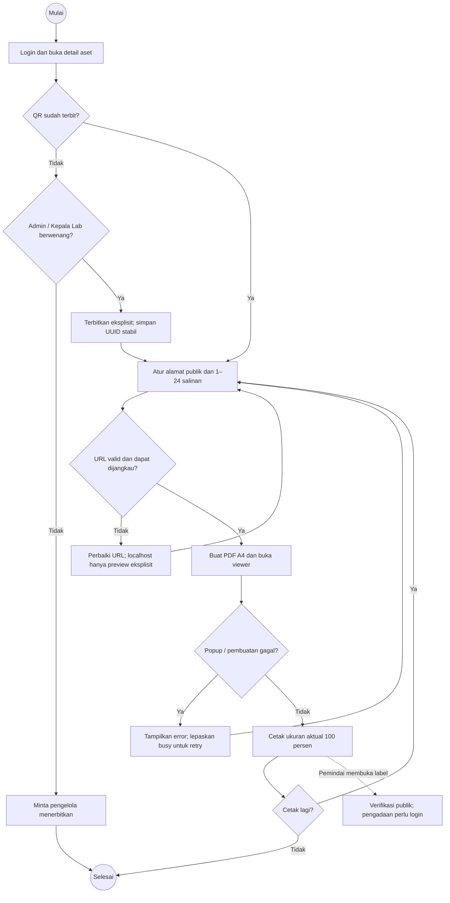

```mermaid
flowchart TD
  subgraph Tiket[Pelapor, pengelola dan teknisi]
    TS((Mulai tiket)) --> CR[Pelapor membuat tiket: new]
    CR --> AS[Ditugaskan / diambil teknisi: assigned]
    AS --> IP[Mulai: in_progress]
    AS --> PE[pending dengan alasan]
    IP --> PE
    PE --> IP
    IP --> LF{Temuan impor belum ditangani?}
    LF -- Ya --> RP[Catat perbaikan berhasil di menu Perbaikan]
    RP --> RE[Resolve disertai solusi: resolved]
    LF -- Tidak --> RE
    RE --> VE{Verifikasi pelapor independen / pengelola}
    VE -- Terima --> CL[closed]
    VE -- Perlu penanganan lagi --> RO[Reopen: assigned atau new]
    CL -- Reopen beralasan --> RO
    RO --> AS
    CR -. Batal sesuai izin .-> CA[cancelled]
    CL --> TE((Selesai tiket))
    CA --> TE
  end
  subgraph Jadwal[Guru, sistem dan pengelola]
    JS((Mulai jadwal)) --> AJ[Guru pilih lab, tanggal dan slot pelajaran]
    AJ --> VA{Input dan slot valid?}
    VA -- Tidak --> AJ
    VA -- Ya --> ME[Pengajuan menunggu peninjauan]
    ME --> AP{Admin / Kepala Lab menyetujui?}
    AP -- Tidak --> RJ[Ditolak; Guru melihat status]
    AP -- Ya --> CF{Masih bebas bentrok?}
    CF -- Tidak --> RJ
    CF -- Ya --> SA[Disetujui; tampil pada jadwal]
    RJ --> JE((Selesai jadwal))
    SA --> JE
  end
```

# Letris

Letris membantu sekolah mengelola laboratorium komputer, aset IT, jadwal pemakaian, dan laporan kerusakan. Guru dapat mengajukan jadwal, pengelola memantau inventaris, dan teknisi mencatat perbaikan dalam satu aplikasi.

Dibangun dengan React 19, Vite, Express 5, dan MySQL.

[Fitur](#fitur-dan-lima-peran) · [Mulai menggunakan](#mulai-menggunakan-letris) · [Dokumentasi API](openapi.json) · [Diagram](#use-case-diagram) · [Pengembangan](#struktur-dan-pengujian)

## Fitur dan lima peran

- Lihat ringkasan aset, kondisi perangkat, dan perkembangan tiket dari dashboard.
- Kelola data lab dan perangkat yang digunakan untuk pembelajaran.
- Catat aset Operasional sekolah, termasuk printer, proyektor, dan perangkat jaringan.
- Terbitkan QR aset, buka halaman verifikasinya, dan cetak ulang label saat diperlukan.
- Laporkan masalah melalui Bantuan lalu ikuti penanganannya lewat status dan komentar.
- Catat pemeriksaan dan perbaikan tanpa kehilangan riwayat pekerjaan sebelumnya.
- Ajukan jadwal lab dan periksa hasil persetujuannya.
- Bagikan pengumuman beserta lampiran kepada pengguna.
- Sesuaikan nama, logo, warna sekolah, dan jam pelajaran.

Panduan awal menjelaskan menu yang tersedia bagi setiap pengguna. Panduan otomatis muncul sekali per akun dan statusnya disimpan di database. Untuk mengulangnya, pilih **Panduan awal** dari menu profil.

| Peran | Tanggung jawab dan batas |
| --- | --- |
| **Admin** | Mengelola akun, lab, aset, pengumuman, jadwal, pengaturan, log aktivitas, penugasan tiket, dan kebijakan SLA. |
| **Koordinator Lab** | Mengelola lab dan pengumuman serta mengatur penanggung jawab tiket sekolah. Dapat melihat aset tetapi tidak mengubahnya. |
| **Kepala Lab** | Mengelola perangkat Pembelajaran dan QR pada lab yang dipimpin serta meninjau pengajuan jadwal. Dapat melihat tiket sendiri dan tiket terkait aset labnya. |
| **Teknisi** | Memeriksa perangkat, mencatat perbaikan, dan melihat antrean tiket. Dapat mengambil tiket yang belum ditugaskan dan mengerjakan tiket miliknya. |
| **Guru** | Melihat jadwal, mengajukan pemakaian lab, memeriksa hasil pengajuan, serta membuat dan mengikuti tiket sendiri. |

Semua pengguna yang sudah login dapat melihat inventaris dan data pengadaan serta mencetak label QR yang sudah diterbitkan. Koordinator, Teknisi, dan Guru tidak dapat mengubah aset. Pengunjung tanpa login hanya dapat membaca informasi QR dan pengumuman publik.

## Cara kerja

Perangkat untuk pembelajaran dikelola melalui **Kelola Data Perangkat** dan terhubung dengan labnya. Menu **Aset IT Sekolah** digunakan untuk perangkat Operasional. Tahun pengadaan, sumber dana, dan harga beli boleh dikosongkan jika belum diketahui.

Saat perangkat bermasalah, pengelola dapat mencatat temuan dan teknisi menambahkan hasil perbaikan. Tiket di menu Bantuan membantu pengguna mengikuti penanganan masalah. Aset boleh dikaitkan ke tiket, tetapi tidak wajib.

Untuk pemakaian lab, Guru mengajukan waktu yang diinginkan. Admin atau Kepala Lab meninjau pengajuan dan sistem memeriksa bentrok jadwal sebelum menyetujuinya.

## Mulai menggunakan Letris

Siapkan **Node.js 24 atau lebih baru**, npm, dan MySQL dengan skema yang sesuai. Jika melanjutkan instalasi yang sudah berjalan, tetap gunakan database dan konfigurasi lokal yang sama.

### Pasang dependensi

Jalankan dari folder utama proyek:

```sh
npm ci
npm --prefix frontend ci
npm --prefix backend ci
```

### Jalankan aplikasi

Buka dua terminal dari folder utama. Jika server sudah berjalan, tidak perlu menjalankannya lagi.

```sh
# Terminal backend
cd backend
npm start
```

```sh
# Terminal frontend
cd frontend
npm run dev
```

Frontend menggunakan port `5174`. Backend mengikuti nilai `PORT` pada konfigurasi dan menggunakan `5000` jika nilai itu belum diatur. Buka alamat yang ditampilkan saat server berhasil berjalan.

Konfigurasi `DB_*` digunakan oleh mysql2, sedangkan `DATABASE_URL` digunakan oleh Prisma. Keduanya harus mengarah ke **database yang sama**. Jangan masukkan sandi, token, atau nilai koneksi ke repository.

Perintah di atas hanya memasang dependensi dan menjalankan aplikasi. Perintah tersebut tidak membuat, menyalin, mengganti, atau mereset database dan tidak membuat akun demo. Migrasi juga tidak dijalankan otomatis. Jika skema belum sesuai, minta pengelola meninjau migrasi dan backup pada database yang sama sebelum menerapkannya. Skrip review bukan langkah instalasi biasa.

### Akses dari perangkat lain

Untuk membuka aplikasi dari HP pada jaringan yang sama, gunakan alamat IP komputer dan port frontend. Jangan gunakan `localhost` di HP karena alamat itu menunjuk ke HP tersebut. Pastikan jaringan dan firewall mengizinkan akses.

Saat pengembangan, Vite meneruskan `/api` dan `/uploads` ke backend. Tujuannya mengikuti `VITE_BASE_URL`, `VITE_ASSET_BASE_URL`, dan bila diperlukan `VITE_DEV_PROXY_TARGET`. Untuk penggunaan di server, siapkan HTTPS, reverse proxy, dan pengaturan agar tautan halaman React tetap bisa dibuka langsung. Konfigurasi produksi dibaca saat build.

## Dokumentasi API

Seluruh endpoint, aturan autentikasi, parameter, contoh data, dan respons tersedia di **[openapi.json](openapi.json)**. Impor file tersebut ke aplikasi yang mendukung OpenAPI untuk membaca atau mencoba API.

Tidak ada halaman Swagger UI bawaan. Membuka file spesifikasi tidak berarti semua endpoint dapat digunakan tanpa login.

## Struktur dan pengujian

```text
README.md              Dokumentasi proyek tunggal
openapi.json           Referensi API tunggal
frontend/              UI React dan Vite
backend/               Express, router, controller, service, repository, Prisma/migrasi
shared/                Aturan/helper lintas aplikasi
test/
  run.mjs              Runner terpusat
  frontend/            Tes frontend
  backend/             Tes backend
  shared/              Tes helper bersama
  contracts/           Tes kontrak
```

Setelah dependensi terpasang, jalankan pemeriksaan dari folder utama:

```sh
npm test
npm run test:frontend
npm run test:backend
npm run test:shared
npm run test:contracts
npm run lint
npm run build
```

`npm test` menjalankan seluruh suite melalui `test/run.mjs`. Perintah lainnya berguna saat hanya ingin memeriksa satu bagian. Semua tes, fixture, dan skrip pengujian berada di folder `test/`.

Tes otomatis memeriksa perilaku kode, tetapi tidak menggantikan uji penggunaan dengan akun sebenarnya, database MySQL, kamera, atau printer fisik. Pengujian yang mengubah data membutuhkan persetujuan terpisah dan tidak termasuk langkah instalasi.

## Use Case Diagram

Diagram ini menunjukkan siapa yang menggunakan setiap fitur. Hak akses lebih rinci mengikuti pembagian peran di atas dan pemeriksaan pada backend.


## Activity Diagram

### Aset → QR → cetak ulang



QR diterbitkan sekali dan tetap memakai identitas yang sama saat label dicetak ulang. Mengubah data inventaris tidak mengganti QR. Jika aset dihapus, tautan lamanya tidak lagi menemukan data. QR adalah tautan ke catatan inventaris, bukan bukti keaslian atau kepemilikan barang.

Halaman publik menampilkan identitas, spesifikasi, nomor inventaris, kondisi, kategori, penggunaan, dan lokasi aset. Foto, data pengadaan, dan identitas pengguna tidak ditampilkan di halaman publik. Data pengadaan baru diminta setelah pengguna login.

Gunakan alamat sekolah yang dapat dibuka ponsel sebelum mencetak label. Alamat dapat diatur melalui `VITE_QR_PUBLIC_ORIGIN` atau kolom alamat publik. Jangan tempel label yang mengarah ke localhost dan pertahankan domain serta jalur halaman setelah label dipasang.

PDF memakai kertas A4 dengan label 90 × 50 mm dan 10 label per halaman. Pengguna dapat memilih 1 sampai 24 salinan dalam satu proses. PDF tetap tersedia selama penampilnya terbuka dan mencetak ulang tidak mengubah data aset. Kemampuan dialog cetak dan printer fisik perlu diperiksa pada perangkat yang digunakan.

### Tiket layanan dan pengajuan jadwal

Tiket layanan dan pengajuan jadwal berjalan terpisah. Pengguna tidak perlu membuat pengajuan jadwal untuk melaporkan masalah.



Temuan pemeriksaan tidak otomatis menjadi tiket. Admin, Koordinator, atau Teknisi dapat mengimpornya melalui tindakan yang tersedia tanpa menggandakan temuan yang sama. Tiket hasil impor baru dapat dinyatakan selesai setelah temuan sumbernya ditangani. Menutup tiket tidak menggantikan pencatatan hasil perbaikan.

Tiket dapat ditunda dengan alasan, dilanjutkan, atau dibuka kembali sesuai izin pengguna. Riwayat tetap disimpan. Jika dua pengguna memperbarui tiket yang sama, sistem dapat meminta data dimuat ulang sebelum perubahan berikutnya disimpan.

Prioritas tiket mengikuti dampak dan urgensinya. Target respons dan penyelesaian disimpan saat tiket dibuat. Perhitungan berjalan sepanjang waktu termasuk saat tiket ditunda, dan membuka ulang tiket tidak mereset waktu awal. Contoh target respons dan penyelesaian dalam menit adalah P1 15/240, P2 60/480, P3 240/1440, dan P4 480/4320. Sekolah perlu menentukan target yang sesuai dengan layanannya.

Jadwal mengikuti jam sekolah dan durasi pelajaran yang diatur pengelola. Jadwal yang bersebelahan diperbolehkan. Saat menyetujui pengajuan, sistem memeriksa bentrok sekali lagi dan menolak pengajuan jika waktunya sudah terpakai. Guru dapat melihat hasilnya melalui menu status pengajuan.

## Keamanan dan batas operasional

Gunakan aplikasi di jaringan yang aksesnya dikelola sekolah. Sebelum membuka akses dari internet, periksa konfigurasi HTTPS, izin pengguna, upload, dan backup database. File upload yang disajikan sebagai berkas statis tidak otomatis menjadi privat hanya karena menu aplikasinya membutuhkan login.

- Sistem memeriksa data yang masih terkait sebelum menghapus. Riwayat pemeriksaan, temuan, perbaikan, dan tiket tidak ikut dihapus otomatis.
- Kondisi aset dapat berupa Baik, Rusak, Perlu Perbaikan, atau Dalam Perbaikan. Jika masih ada temuan aktif, selesaikan penanganannya sebelum mengganti kondisi secara manual.
- Log aktivitas hanya dapat dibuka Admin. Log membantu penelusuran, tetapi gangguan layanan dapat menyebabkan sebagian catatan tidak tersimpan. Tetapkan kebijakan penyimpanan dan backup sendiri.
- Logo sekolah mendukung gambar raster sampai 2 MiB. Validasi gambar bukan pengganti pemeriksaan malware dan SVG tidak didukung.
- Jangan menaruh sandi, token, konfigurasi privat, atau data pribadi yang tidak diperlukan pada tiket dan lampiran.

Alur Bantuan mengambil beberapa konsep dari GLPI dalam bentuk yang lebih sederhana. Penggunaan Letris tidak berarti sekolah sudah memenuhi atau memperoleh sertifikasi ISO/IEC 20000-1.

## Catatan arsip dan keamanan repository

Riwayat lama repository pernah memuat konfigurasi privat dan dump data. Menghapus berkas dari versi terbaru tidak menghapus salinannya dari riwayat Git, branch arsip, atau clone yang sudah ada. Jangan menganggap seluruh riwayat aman hanya karena berkas tersebut tidak lagi terlihat pada versi sekarang.

<details>
<summary>Informasi arsip v1</summary>

Baseline pengembangan lama adalah commit `92633b3f1780857afe79c9a341f2a2a979cc8536` dan disimpan pada `archive/v1-92633b3`.

Tag `v1.0.0` mengarah ke snapshot tersanitasi `6cbd6d170f2d9e2cc9af9425d680cf4c14e125c3`. Snapshot ini mempertahankan 123 berkas source asli tanpa konfigurasi privat dan dua dump SQL yang berisi data akun. Karena ada pengecualian tersebut, snapshot arsip bukan salinan tanpa perubahan dari commit baseline dan bukan backup database.

Tag arsip tidak menghapus paparan pada riwayat sebelumnya. Catatan keamanan lama juga mencatat penggantian signing key JWT, bukan pembersihan seluruh riwayat Git. Penulisan README ini tidak melakukan rotasi kunci, reset akun, perubahan database, atau penghapusan riwayat.

</details>
