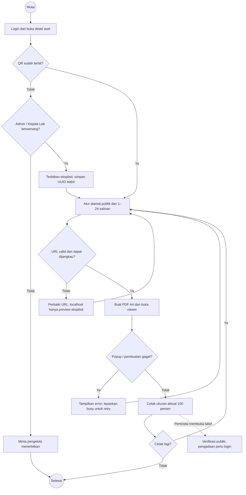

```mermaid
flowchart TD
  subgraph Tiket[Pelapor, pengelola dan teknisi]
    TS((Mulai tiket)) --> CR[Pelapor membuat tiket: new]
    CR --> AS[Ditugaskan / diambil teknisi: assigned]
    AS --> IP[Mulai: in_progress]
    AS --> PE[pending dengan alasan]
    IP --> PE
    PE --> IP
    IP --> LF{Temuan impor belum ditangani?}
    LF -- Ya --> RP[Catat perbaikan berhasil di menu Perbaikan]
    RP --> RE[Resolve disertai solusi: resolved]
    LF -- Tidak --> RE
    RE --> VE{Verifikasi pelapor independen / pengelola}
    VE -- Terima --> CL[closed]
    VE -- Perlu penanganan lagi --> RO[Reopen: assigned atau new]
    CL -- Reopen beralasan --> RO
    RO --> AS
    CR -. Batal sesuai izin .-> CA[cancelled]
    CL --> TE((Selesai tiket))
    CA --> TE
  end
  subgraph Jadwal[Guru, sistem dan pengelola]
    JS((Mulai jadwal)) --> AJ[Guru pilih lab, tanggal dan slot pelajaran]
    AJ --> VA{Input dan slot valid?}
    VA -- Tidak --> AJ
    VA -- Ya --> ME[Pengajuan menunggu peninjauan]
    ME --> AP{Admin / Kepala Lab menyetujui?}
    AP -- Tidak --> RJ[Ditolak; Guru melihat status]
    AP -- Ya --> CF{Masih bebas bentrok?}
    CF -- Tidak --> RJ
    CF -- Ya --> SA[Disetujui; tampil pada jadwal]
    RJ --> JE((Selesai jadwal))
    SA --> JE
  end
```

# Sistem Manajemen IT dan Penggunaan Lab

Sistem Manajemen IT dan Penggunaan Lab membantu sekolah mengelola laboratorium komputer, aset IT, jadwal pemakaian, dan laporan kerusakan. Guru dapat mengajukan jadwal, pengelola memantau inventaris, dan teknisi mencatat perbaikan dalam satu aplikasi.

Dibangun dengan React 19, Vite, Express 5, dan MySQL.

[Fitur](#fitur-dan-lima-peran) · [Development lokal](#development-lokal) · [Production server](#production-server) · [Dokumentasi API](openapi.json) · [Diagram](#use-case-diagram) · [Pengujian](#struktur-dan-pengujian)

## Fitur dan lima peran

- Lihat ringkasan aset, kondisi perangkat, dan perkembangan tiket dari dashboard.
- Kelola data lab dan perangkat yang digunakan untuk pembelajaran.
- Catat aset Operasional sekolah, termasuk printer, proyektor, dan perangkat jaringan.
- Terbitkan QR aset, buka halaman verifikasinya, dan cetak ulang label saat diperlukan.
- Laporkan masalah melalui Bantuan lalu ikuti penanganannya lewat status dan komentar.
- Catat pemeriksaan dan perbaikan tanpa kehilangan riwayat pekerjaan sebelumnya.
- Ajukan jadwal lab dan periksa hasil persetujuannya.
- Bagikan pengumuman beserta lampiran kepada pengguna.
- Sesuaikan nama, logo, warna sekolah, dan jam pelajaran.

Panduan awal menjelaskan menu yang tersedia bagi setiap pengguna. Panduan otomatis muncul sekali per akun dan statusnya disimpan di database. Untuk mengulangnya, pilih **Panduan awal** dari menu profil.

| Peran | Tanggung jawab dan batas |
| --- | --- |
| **Admin** | Mengelola akun, lab, aset, pengumuman, jadwal, pengaturan, log aktivitas, penugasan tiket, dan kebijakan SLA. |
| **Koordinator Lab** | Mengelola lab dan pengumuman serta mengatur penanggung jawab tiket sekolah. Dapat melihat aset tetapi tidak mengubahnya. |
| **Kepala Lab** | Mengelola perangkat Pembelajaran dan QR pada lab yang dipimpin serta meninjau pengajuan jadwal. Dapat melihat tiket sendiri dan tiket terkait aset labnya. |
| **Teknisi** | Memeriksa perangkat, mencatat perbaikan, dan melihat antrean tiket. Dapat mengambil tiket yang belum ditugaskan dan mengerjakan tiket miliknya. |
| **Guru** | Melihat jadwal, mengajukan pemakaian lab, memeriksa hasil pengajuan, serta membuat dan mengikuti tiket sendiri. |

Semua pengguna yang sudah login dapat melihat inventaris dan data pengadaan serta mencetak label QR yang sudah diterbitkan. Koordinator, Teknisi, dan Guru tidak dapat mengubah aset. Pengunjung tanpa login hanya dapat membaca informasi QR dan pengumuman publik.

## Cara kerja

Perangkat untuk pembelajaran dikelola melalui **Kelola Data Perangkat** dan terhubung dengan labnya. Menu **Aset IT Sekolah** digunakan untuk perangkat Operasional. Tahun pengadaan, sumber dana, dan harga beli boleh dikosongkan jika belum diketahui.

Saat perangkat bermasalah, pengelola dapat mencatat temuan dan teknisi menambahkan hasil perbaikan. Tiket di menu Bantuan membantu pengguna mengikuti penanganan masalah. Aset boleh dikaitkan ke tiket, tetapi tidak wajib.

Untuk pemakaian lab, Guru mengajukan waktu yang diinginkan. Admin atau Kepala Lab meninjau pengajuan dan sistem memeriksa bentrok jadwal sebelum menyetujuinya.

## Development lokal

Panduan ini untuk mengubah dan mencoba kode, bukan menjalankan layanan publik. Gunakan **Node.js >=24**, npm, dan **MySQL 8**. Perintah shell memakai Bash: Windows dapat memakai Git Bash atau WSL. Pasang MySQL Server beserta kliennya terlebih dahulu, aktifkan layanan, dan pastikan `node --version`, `npm --version`, serta `mysql --version` berhasil. Pada Git Bash, tambahkan folder `bin` instalasi MySQL ke PATH; pada WSL, gunakan alamat server MySQL yang benar untuk lingkungan tersebut.

### 1. Pilih instalasi yang sesuai

- **Instalasi sudah ada:** pertahankan database aktif, `backend/.env`, dan konfigurasi frontend. **Lewati seluruh langkah CREATE, import baseline, dan pembuatan Admin.** Jangan mengganti target ke contoh database di bawah. Jika ada kekurangan skema, pengelola harus meninjau metadata, backup, dan perubahan yang diperlukan pada target yang sudah disetujui.
- **Instalasi baru:** gunakan database baru yang kosong dan terpisah, misalnya `itlab_dev_baru`. Ikuti [inisialisasi database baru](#inisialisasi-database-baru) sebelum menjalankan backend. Jangan menjalankan seeder review.

### 2. Pasang dependensi dan konfigurasi

Dari folder utama source yang sudah tersedia:

```sh
npm ci
npm --prefix backend ci
npm --prefix frontend ci
# Hanya untuk instalasi BARU; jangan menimpa .env yang sudah ada
cp -n backend/.env.example backend/.env
```

Edit `backend/.env` secara lokal. Template `.env.example` tidak berisi kredensial nyata. Untuk instalasi baru, isi:

```dotenv
DB_HOST=127.0.0.1
DB_PORT=3306
DB_USER=itlab_dev_app
DB_PASSWORD=<SANDI_KUAT_UNIK_DATABASE_DEV>
DB_NAME=itlab_dev_baru
DATABASE_URL="mysql://itlab_dev_app:<SANDI_URL_ENCODED>@127.0.0.1:3306/itlab_dev_baru"
PORT=5000
NODE_ENV=development
JWT_SECRET=<RAHASIA_ACAK_PERTAMA>
JWT_REFRESH_SECRET=<RAHASIA_ACAK_KEDUA>
```

`DB_*` untuk mysql2 dan `DATABASE_URL` untuk Prisma harus menunjuk host, akun, dan database **yang sama**. Sandi pada `DB_PASSWORD` adalah nilai asli; hanya sandi di URL yang di-percent-encode. Jangan menyalin placeholder secara harfiah atau memasukkan konfigurasi privat ke Git.

Hanya pada instalasi **baru**, buat dua secret berbeda dengan perintah berikut, lalu simpan hasilnya pada dua variabel JWT. Jangan mengganti secret instalasi berjalan pada setiap deploy karena sesi yang ada akan terputus.

```sh
node -e 'const c=require("node:crypto"); console.log(c.randomBytes(48).toString("hex")); console.log(c.randomBytes(48).toString("hex"))'
```

Buat atau sesuaikan `frontend/.env.local` tanpa menimpa konfigurasi yang masih dipakai:

```dotenv
VITE_BASE_URL=/api
VITE_DEV_PROXY_TARGET=http://127.0.0.1:5000
VITE_ASSET_BASE_URL=http://localhost:5000
```

Vite meneruskan `/api` dan `/uploads` ke backend, sehingga browser tetap memakai origin frontend. Untuk label QR yang dipindai HP, atur `VITE_QR_PUBLIC_ORIGIN=http://<IP-LAN-KOMPUTER>:5174` dan pastikan alamat itu dapat dijangkau. `localhost` hanya untuk preview lokal yang dipilih secara eksplisit, bukan label yang ditempel pada aset.

### 3. Generate client dan jalankan

Setelah database siap, jalankan dari root:

```sh
(cd backend && npx --no-install prisma generate)
```

Perintah tersebut memakai Prisma **6 dari lockfile**, bukan memasang Prisma terbaru. `prisma generate` hanya menghasilkan client; **tidak membuat tabel**. Jangan memakai `db push` atau `migrate dev` sebagai pengganti prosedur skema production.

Buka dua terminal dari root (jangan membuat proses kedua jika layanan sudah berjalan):

```sh
# Terminal 1
cd backend
npm start
```

```sh
# Terminal 2
cd frontend
npm run dev
```

Buka `http://localhost:5174`. Backend memakai `PORT=5000`. Untuk akses HP satu jaringan, buka `http://<IP-LAN-KOMPUTER>:5174`, bukan localhost HP. Izinkan akses LAN seperlunya; jangan membuka MySQL ke internet. Lanjutkan [smoke check](#pemeriksaan-setelah-menjalankan).

## Production server

Bagian ini adalah **contoh deployment Ubuntu 24.04, Nginx, systemd, MySQL 8, dan Node.js >=24 yang dipasang secara global**. OS server sebenarnya belum ditentukan; sesuaikan perintah bila berbeda. Semua perintah administrasi di sini untuk operator yang berwenang, bukan pekerjaan otomatis saat mengedit README.

### 1. Siapkan server dan jalur aplikasi

Pastikan DNS domain sekolah menunjuk ke server. Contoh lokasi source adalah `/srv/itlab`; sediakan rilis source yang sudah ditinjau di sana dengan pemilik operator yang menjalankan build. Jangan menyalin `.env` atau dump privat ke repository.

```sh
sudo apt update
sudo apt install mysql-server mysql-client nginx curl ca-certificates
sudo systemctl enable --now mysql nginx
```

Jika Node.js yang sesuai belum tersedia, contoh berikut memakai distribusi NodeSource untuk Node 24. Unduh dan periksa skrip pemasang sebelum menjalankannya sebagai administrator. Langkah ini memasang paket sistem dan hanya untuk operator server:

```sh
curl -fsSL https://deb.nodesource.com/setup_24.x -o "$HOME/nodesource_setup.sh"
less "$HOME/nodesource_setup.sh"
sudo bash "$HOME/nodesource_setup.sh"
sudo apt install nodejs
node --version
npm --version
mysql --version
command -v node
```

Verifikasi MySQL versi 8. Buat user layanan non-root khusus, misalnya `itlab`, tanpa login interaktif. Berikan akses baca source dan tulis hanya ke direktori yang diperlukan, terutama `/srv/itlab/backend/uploads`; jangan gunakan `chmod 777`. Operator/build user dapat memiliki hak berbeda dari user runtime.

Contoh pembuatan user layanan bila belum ada:

```sh
id itlab >/dev/null 2>&1 || sudo useradd --system --user-group --create-home --home-dir /var/lib/itlab --shell /usr/sbin/nologin itlab
sudo install -d -o itlab -g itlab -m 0750 /srv/itlab/backend/uploads
```

Pastikan user `itlab` dapat membaca source backend dan dependensinya. Nginx juga harus bisa melewati direktori induk dan membaca `frontend/dist`; folder publik umumnya memakai mode `755` dan berkasnya `644`. Jangan menerapkan izin publik tersebut ke `.env` atau seluruh direktori backend.

### 2. Siapkan database dan konfigurasi production

- **Server sudah terpasang:** pertahankan target database dan `.env` yang digunakan proses aktif. Jangan menjalankan baseline atau membuat akun awal lagi.
- **Pindah dari instalasi lama:** operator memulihkan backup tepercaya ke target yang telah disetujui, memverifikasi hasil restore dan metadata, lalu hanya menerapkan perubahan skema yang masih diperlukan. Jangan mengimpor baseline di atas hasil restore atau memakai dump arsip repository.
- **Benar-benar baru:** gunakan contoh target `itlab_prod_baru` dan akun `itlab_prod_app`, berbeda dari development. Ikuti [inisialisasi database baru](#inisialisasi-database-baru), termasuk skema fitur dan Admin awal.

Untuk instalasi baru saja, salin `backend/.env.example` ke `backend/.env` tanpa menimpa file lama. Isi dengan bentuk konfigurasi development di atas, tetapi gunakan akun/target production, `NODE_ENV=production`, `PORT=5000`, dan dua secret production baru. Lindungi file dengan pemilik operator/build user, grup `itlab`, dan mode `640`; operator tetap bisa menjalankan generate Prisma, sedangkan user layanan mendapat akses baca. Jangan mencetak isinya ke log. Akun runtime hanya mendapat `SELECT, INSERT, UPDATE, DELETE`; jalankan DDL memakai sesi administrator MySQL terpisah, bukan kredensial aplikasi.

Setelah file konfigurasi selesai dibuat, contoh pengaturan izinnya:

```sh
sudo chown "$(id -un):itlab" /srv/itlab/backend/.env
sudo chmod 640 /srv/itlab/backend/.env
```

### 3. Build frontend untuk domain sebenarnya

Sebelum build, buat atau sesuaikan `frontend/.env.production`:

```dotenv
VITE_BASE_URL=/api
VITE_ASSET_BASE_URL=https://itlab.sekolah.example
VITE_QR_PUBLIC_ORIGIN=https://itlab.sekolah.example
```

**Ganti domain contoh dengan domain HTTPS sekolah yang sebenarnya sebelum build.** Periksa juga `.env.local` dan environment build agar tidak menimpa nilai production. Variabel `VITE_*` masuk ke berkas browser dan tidak boleh berisi secret. Jalankan sebagai operator/build user dari `/srv/itlab`:

```sh
npm ci
npm --prefix backend ci
npm --prefix frontend ci
(cd backend && npx --no-install prisma generate)
npm --prefix frontend run build
```

Hasil statis ada di `frontend/dist`. Production **tidak** memakai `vite dev` atau `vite preview`.

### 4. Jalankan backend dengan systemd

Gunakan hasil absolut `command -v node` dari instalasi global. Contoh `/usr/bin/node` di bawah harus diganti jika hasilnya berbeda; jangan mengasumsikan path NVM milik user lain. Buat `/etc/systemd/system/itlab.service`:

```ini
[Unit]
Description=Sistem Manajemen IT dan Penggunaan Lab
After=network.target mysql.service

[Service]
Type=simple
User=itlab
Group=itlab
WorkingDirectory=/srv/itlab/backend
EnvironmentFile=/srv/itlab/backend/.env
ExecStart=/usr/bin/node /srv/itlab/backend/index.js
Restart=on-failure
UMask=0027

[Install]
WantedBy=multi-user.target
```

Setelah skema dan konfigurasi diverifikasi:

```sh
sudo systemctl daemon-reload
sudo systemctl enable --now itlab
sudo systemctl status itlab --no-pager
```

Backend saat ini bind ke **`0.0.0.0`**, bukan hanya localhost. Firewall host dan firewall penyedia server harus memblokir akses internet ke **5000 dan 3306**. Izinkan 80/443 serta **port SSH yang benar-benar digunakan** sebelum mengaktifkan firewall agar tidak terkunci keluar. Nginx tetap mengakses backend melalui loopback.

### 5. Nginx dan HTTPS

Buat site `/etc/nginx/sites-available/itlab` untuk domain sebenarnya. Contoh blok HTTP awal berikut dipakai untuk penerbitan sertifikat, bukan untuk login production:

```nginx
server {
    listen 80;
    server_name itlab.sekolah.example;
    root /srv/itlab/frontend/dist;
    index index.html;
    client_max_body_size 20m;

    location /api {
        proxy_pass http://127.0.0.1:5000;
        proxy_set_header Host $host;
        proxy_set_header X-Forwarded-For $proxy_add_x_forwarded_for;
        proxy_set_header X-Forwarded-Proto $scheme;
    }
    location /uploads {
        proxy_pass http://127.0.0.1:5000;
        proxy_set_header Host $host;
        proxy_set_header X-Forwarded-For $proxy_add_x_forwarded_for;
        proxy_set_header X-Forwarded-Proto $scheme;
    }
    location / {
        try_files $uri $uri/ /index.html;
    }
}
```

Untuk site baru, buat tautan berikut satu kali. Jika tautan sudah ada, lewati perintah tersebut. Jangan membuat konfigurasi ganda untuk domain yang sudah dikelola site lain:

```sh
sudo ln -s /etc/nginx/sites-available/itlab /etc/nginx/sites-enabled/itlab
```

Periksa konfigurasi sebelum memuat ulang Nginx:

```sh
sudo nginx -t
sudo systemctl reload nginx
sudo apt install certbot python3-certbot-nginx
sudo certbot --nginx -d itlab.sekolah.example
sudo certbot renew --dry-run
```

Ganti domain pada konfigurasi **dan** perintah Certbot. DNS serta port 80/443 harus dapat dijangkau untuk validasi sertifikat. Aktifkan redirect HTTP ke HTTPS dan pastikan HTTPS berfungsi **sebelum login**; cookie refresh production menggunakan atribut Secure. `proxy_pass` sengaja **tanpa trailing slash** agar `/api` dan `/uploads` tetap diteruskan utuh. Batas Nginx 20 MiB memberi ruang multipart untuk batas upload backend 10 MiB; logo tetap dibatasi 2 MiB. SPA fallback memungkinkan tautan halaman React dibuka langsung.

**Catatan sesi login:** kode saat ini belum memiliki alur refresh token yang konsisten antara frontend dan backend. HTTPS tidak memperbaiki masalah tersebut. Access token berlaku satu jam dan pengguna mungkin perlu login kembali setelah kedaluwarsa. Uji perilaku sesi sebelum penggunaan production dan rencanakan perbaikan refresh sebagai perubahan kode terpisah.

### 6. Backup dan pembaruan

Sebelum upgrade, operator membuat backup MySQL dengan akun backup yang disetujui (misalnya `mysqldump --single-transaction --routines --triggers -u <AKUN_BACKUP> -p <DATABASE_TERVERIFIKASI> > <LOKASI_BACKUP_DI_LUAR_REPO>.sql`) dan menyalin `backend/uploads` serta konfigurasi privat ke penyimpanan terlindungi di luar Git. Gunakan snapshot/maintenance yang sesuai agar database dan upload konsisten. Uji restore secara terpisah sebelum mengandalkan backup.

Pasang source rilis yang ditinjau tanpa menghapus `.env` atau upload. Jalankan kembali `npm ci` pada root/backend/frontend, generate Prisma client, dan build frontend. Tinjau hanya SQL perubahan yang diperlukan terhadap metadata target; jangan mengulang baseline, DDL fresh, atau membuat ulang Admin. Setelah semua siap, operator menjalankan **satu** `sudo systemctl restart itlab`, memeriksa status/log layanan tanpa membocorkan secret, lalu melakukan smoke check. Nginx hanya perlu reload bila konfigurasinya berubah. Rollback source harus mempertimbangkan kompatibilitas skema dan backup, bukan mereset database secara otomatis.

## Inisialisasi database baru

**Khusus instalasi baru pada database kosong yang telah disetujui. Bukan prosedur upgrade atau perintah untuk database aktif.** Langkah ini dipakai development maupun production; pilih satu target yang benar. DDL MySQL auto-commit. Hentikan bila target atau struktur berbeda dari yang diharapkan.

<details>
<summary>1. Buat database kosong dan akun runtime dengan administrator MySQL</summary>

Masuk sebagai administrator MySQL (`mysql -u root -p`, atau `sudo mysql` pada Ubuntu dengan socket authentication). Contoh development:

```sql
CREATE DATABASE `itlab_dev_baru` CHARACTER SET utf8mb4 COLLATE utf8mb4_unicode_ci;
CREATE USER 'itlab_dev_app'@'127.0.0.1' IDENTIFIED BY '<SANDI_KUAT_UNIK_DEV_GANTI_SEBELUM_EKSEKUSI>';
GRANT SELECT, INSERT, UPDATE, DELETE ON `itlab_dev_baru`.* TO 'itlab_dev_app'@'127.0.0.1';
```

Untuk production baru, gunakan contoh terpisah berikut, **bukan keduanya**:

```sql
CREATE DATABASE `itlab_prod_baru` CHARACTER SET utf8mb4 COLLATE utf8mb4_unicode_ci;
CREATE USER 'itlab_prod_app'@'127.0.0.1' IDENTIFIED BY '<SANDI_KUAT_UNIK_PROD_GANTI_SEBELUM_EKSEKUSI>';
GRANT SELECT, INSERT, UPDATE, DELETE ON `itlab_prod_baru`.* TO 'itlab_prod_app'@'127.0.0.1';
```

Ganti setiap placeholder dengan sandi kuat unik dan lindungi riwayat sesi administrator. Sesuaikan host akun dengan koneksi lokal MySQL yang disetujui; jangan memberi akses host `%` atau menggunakan root sebagai user aplikasi. Administrator tetap dipakai untuk langkah DDL berikut.

</details>

<details>
<summary>2. Impor baseline sekali, lalu lengkapi skema fitur</summary>

Dari root source, buka sesi administrator langsung ke **database baru pilihan**, misalnya `mysql -u root -p itlab_dev_baru` (production: `mysql -u root -p itlab_prod_baru`; socket Ubuntu: `sudo mysql itlab_prod_baru`). Di sesi itu:

```sql
SELECT DATABASE();
SHOW TABLES;
```

Lanjutkan hanya jika nama tepat dan **tidak ada tabel**. Jalankan berurutan dari working directory root proyek agar jalur SOURCE benar:

```sql
SOURCE backend/prisma/migrations/20250817184415_init/migration.sql;
SOURCE backend/migrations/20261102_school_settings_activity_logs.sql;
SOURCE backend/migrations/20261103_service_tickets.sql;
```

Baseline hanya sekali pada database kosong, tidak untuk upgrade. Migrasi fitur berada di luar direktori migrasi Prisma; **`prisma migrate deploy` saja tidak melengkapi skema aplikasi**. Import SQL manual juga tidak mencatat riwayat pada `_prisma_migrations`. Jangan mencampurkan resep ini dengan workflow Prisma Migrate tanpa peninjauan dan baselining yang sesuai. Panduan ini tidak menjalankan runner bootstrap otomatis.

**Jangan SOURCE `20261114_school_assets.sql` atau `20261115_asset_qr.sql` secara buta di production.** Keduanya ditulis untuk review; SQL QR sengaja no-op di luar allowlist `simlab_review_` diikuti 14 digit. Jangan menonaktifkan guard atau memakai helper clone review. Untuk database baru yang baru saja menerima baseline di atas, administrator meninjau dan menjalankan DDL ekuivalen berikut **sekali saja**:

```sql
ALTER TABLE perangkat
  MODIFY COLUMN lab_id INT NULL,
  ADD COLUMN penggunaan ENUM('Pembelajaran','Operasional') NOT NULL DEFAULT 'Pembelajaran',
  ADD COLUMN kategori ENUM('Komputer','Laptop','Monitor','Printer','Perangkat Jaringan','Proyektor','Lainnya') NOT NULL DEFAULT 'Lainnya',
  ADD COLUMN lokasi VARCHAR(150) NULL,
  ADD COLUMN tahun_pengadaan SMALLINT NULL,
  ADD COLUMN sumber_dana VARCHAR(150) NULL,
  ADD COLUMN harga_beli DECIMAL(15,2) NULL,
  ADD COLUMN qr_public_id CHAR(36) CHARACTER SET ascii COLLATE ascii_bin NULL,
  ADD UNIQUE INDEX uq_perangkat_qr_public_id (qr_public_id);
```

Jangan gunakan DDL fresh tersebut bila kolom sudah ada. Untuk onboarding, setelah operator memverifikasi dan menyetujui target `SELECT DATABASE()` pada sesi yang sama:

```sql
SET @onboarding_expected_database = DATABASE();
SOURCE backend/migrations/20261116_onboarding.sql;
SHOW CREATE TABLE perangkat;
SHOW COLUMNS FROM user LIKE 'onboarding_seen_at';
SHOW TABLES;
```

Guard onboarding tetap dipertahankan; jangan menetapkan expected database sebelum mencocokkan target yang disetujui. Kolom `onboarding_seen_at` harus `DATETIME NULL DEFAULT NULL`. Verifikasi juga kolom aset/QR, indeks unik QR, serta tabel settings, activity logs, dan tiket. Untuk instalasi yang sudah berjalan, ikuti instruksi operator pada `20261116_onboarding_instructions.sql`, bukan urutan fresh ini.

</details>

<details>
<summary>3. Buat Admin pertama hanya bila tabel user masih kosong</summary>

Database baru tidak memiliki akun login default. Setelah dependensi backend terpasang, buat hash bcrypt dengan cost 12 melalui Bash; sandi tidak diletakkan pada argumen CLI:

```sh
cd backend
read -rs -p 'Sandi Admin baru: ' ADMIN_PASSWORD; printf '\n'
export ADMIN_PASSWORD
node --input-type=module -e 'import bcrypt from "bcrypt"; if (!process.env.ADMIN_PASSWORD) throw new Error("Sandi kosong"); console.log(await bcrypt.hash(process.env.ADMIN_PASSWORD, 12))'
unset ADMIN_PASSWORD
cd ..
```

Salin hash yang dihasilkan ke `<HASH_BCRYPT>` dalam sesi SQL administrator, bukan sandi aslinya. Isi identitas Admin nyata dan gunakan INSERT berparameter di bawah. Pastikan `SELECT COUNT(*) FROM user;` bernilai 0 sebelum melanjutkan; jangan menimpa akun instalasi lama.

```sql
SET @admin_username = '<USERNAME_ADMIN>';
SET @admin_hash = '<HASH_BCRYPT>';
SET @admin_name = '<NAMA_ADMIN>';
SET @admin_email = '<EMAIL_ADMIN>';
PREPARE initial_admin FROM 'INSERT INTO user (username,password,nama_lengkap,email,role,is_online) VALUES (?,?,?,?,?,FALSE)';
SET @admin_role = 'Admin';
EXECUTE initial_admin USING @admin_username, @admin_hash, @admin_name, @admin_email, @admin_role;
DEALLOCATE PREPARE initial_admin;
SELECT user_id, username, role FROM user;
SET @admin_hash = NULL;
```

Hash juga sensitif; jangan commit atau memasukkannya ke tiket/log publik. Tidak perlu seed review atau akun demo. Setelah login Admin, buat akun pengguna melalui fitur aplikasi sesuai perannya.

</details>

## Pemeriksaan setelah menjalankan

Development:

```sh
curl -i http://127.0.0.1:5000/api/settings
curl -i http://127.0.0.1:5000/api/onboarding
curl -i http://localhost:5174/api/settings
```

Production, setelah HTTPS aktif (ganti domain):

```sh
curl -i https://itlab.sekolah.example/api/settings
curl -i https://itlab.sekolah.example/api/onboarding
```

Settings adalah endpoint publik yang mengembalikan pengaturan/default. Onboarding tanpa token diharapkan **403**, bukan halaman HTML frontend atau login sukses. Ini pemeriksaan rute, bukan endpoint health khusus atau bukti seluruh database sudah benar. Periksa login melalui browser, muat ulang tautan halaman langsung, logo/upload, dan akses sesuai peran. Uji QR dengan HP pada origin sebenarnya; tindakan yang menulis data hanya dilakukan dengan akun dan persetujuan pengujian. Jangan menganggap respons yang dicontohkan sebagai hasil pengujian production.

## Dokumentasi API

Seluruh endpoint, aturan autentikasi, parameter, contoh data, dan respons tersedia di **[openapi.json](openapi.json)**. Impor file tersebut ke aplikasi yang mendukung OpenAPI untuk membaca atau mencoba API.

Tidak ada halaman Swagger UI bawaan. Membuka file spesifikasi tidak berarti semua endpoint dapat digunakan tanpa login.

## Struktur dan pengujian

```text
README.md              Dokumentasi proyek tunggal
openapi.json           Referensi API tunggal
frontend/              UI React dan Vite
backend/               Express, router, controller, service, repository, Prisma/migrasi
shared/                Aturan/helper lintas aplikasi
test/
  run.mjs              Runner terpusat
  frontend/            Tes frontend
  backend/             Tes backend
  shared/              Tes helper bersama
  contracts/           Tes kontrak
```

Setelah dependensi terpasang, jalankan pemeriksaan dari folder utama:

```sh
npm test
npm run test:frontend
npm run test:backend
npm run test:shared
npm run test:contracts
npm run lint
npm run build
```

`npm test` menjalankan seluruh suite melalui `test/run.mjs`. Perintah lainnya berguna saat hanya ingin memeriksa satu bagian. Semua tes, fixture, dan skrip pengujian berada di folder `test/`.

Tes otomatis memeriksa perilaku kode, tetapi tidak menggantikan uji penggunaan dengan akun sebenarnya, database MySQL, kamera, atau printer fisik. Pengujian yang mengubah data membutuhkan persetujuan terpisah dan tidak termasuk langkah instalasi.

## Use Case Diagram

Diagram ini menunjukkan siapa yang menggunakan setiap fitur. Hak akses lebih rinci mengikuti pembagian peran di atas dan pemeriksaan pada backend.


## Activity Diagram

### Aset → QR → cetak ulang



QR diterbitkan sekali dan tetap memakai identitas yang sama saat label dicetak ulang. Mengubah data inventaris tidak mengganti QR. Jika aset dihapus, tautan lamanya tidak lagi menemukan data. QR adalah tautan ke catatan inventaris, bukan bukti keaslian atau kepemilikan barang.

Halaman publik menampilkan identitas, spesifikasi, nomor inventaris, kondisi, kategori, penggunaan, dan lokasi aset. Foto, data pengadaan, dan identitas pengguna tidak ditampilkan di halaman publik. Data pengadaan baru diminta setelah pengguna login.

Gunakan alamat sekolah yang dapat dibuka ponsel sebelum mencetak label. Alamat dapat diatur melalui `VITE_QR_PUBLIC_ORIGIN` atau kolom alamat publik. Jangan tempel label yang mengarah ke localhost dan pertahankan domain serta jalur halaman setelah label dipasang.

PDF memakai kertas A4 dengan label 90 × 50 mm dan 10 label per halaman. Pengguna dapat memilih 1 sampai 24 salinan dalam satu proses. PDF tetap tersedia selama penampilnya terbuka dan mencetak ulang tidak mengubah data aset. Kemampuan dialog cetak dan printer fisik perlu diperiksa pada perangkat yang digunakan.

### Tiket layanan dan pengajuan jadwal

Tiket layanan dan pengajuan jadwal berjalan terpisah. Pengguna tidak perlu membuat pengajuan jadwal untuk melaporkan masalah.



Temuan pemeriksaan tidak otomatis menjadi tiket. Admin, Koordinator, atau Teknisi dapat mengimpornya melalui tindakan yang tersedia tanpa menggandakan temuan yang sama. Tiket hasil impor baru dapat dinyatakan selesai setelah temuan sumbernya ditangani. Menutup tiket tidak menggantikan pencatatan hasil perbaikan.

Tiket dapat ditunda dengan alasan, dilanjutkan, atau dibuka kembali sesuai izin pengguna. Riwayat tetap disimpan. Jika dua pengguna memperbarui tiket yang sama, sistem dapat meminta data dimuat ulang sebelum perubahan berikutnya disimpan.

Prioritas tiket mengikuti dampak dan urgensinya. Target respons dan penyelesaian disimpan saat tiket dibuat. Perhitungan berjalan sepanjang waktu termasuk saat tiket ditunda, dan membuka ulang tiket tidak mereset waktu awal. Contoh target respons dan penyelesaian dalam menit adalah P1 15/240, P2 60/480, P3 240/1440, dan P4 480/4320. Sekolah perlu menentukan target yang sesuai dengan layanannya.

Jadwal mengikuti jam sekolah dan durasi pelajaran yang diatur pengelola. Jadwal yang bersebelahan diperbolehkan. Saat menyetujui pengajuan, sistem memeriksa bentrok sekali lagi dan menolak pengajuan jika waktunya sudah terpakai. Guru dapat melihat hasilnya melalui menu status pengajuan.

## Keamanan dan batas operasional

Gunakan aplikasi di jaringan yang aksesnya dikelola sekolah. Sebelum membuka akses dari internet, periksa konfigurasi HTTPS, izin pengguna, upload, dan backup database. File upload yang disajikan sebagai berkas statis tidak otomatis menjadi privat hanya karena menu aplikasinya membutuhkan login.

- Sistem memeriksa data yang masih terkait sebelum menghapus. Riwayat pemeriksaan, temuan, perbaikan, dan tiket tidak ikut dihapus otomatis.
- Kondisi aset dapat berupa Baik, Rusak, Perlu Perbaikan, atau Dalam Perbaikan. Jika masih ada temuan aktif, selesaikan penanganannya sebelum mengganti kondisi secara manual.
- Log aktivitas hanya dapat dibuka Admin. Log membantu penelusuran, tetapi gangguan layanan dapat menyebabkan sebagian catatan tidak tersimpan. Tetapkan kebijakan penyimpanan dan backup sendiri.
- Logo sekolah mendukung gambar raster sampai 2 MiB. Validasi gambar bukan pengganti pemeriksaan malware dan SVG tidak didukung.
- Jangan menaruh sandi, token, konfigurasi privat, atau data pribadi yang tidak diperlukan pada tiket dan lampiran.

Alur Bantuan mengambil beberapa konsep dari GLPI dalam bentuk yang lebih sederhana. Penggunaan Sistem Manajemen IT dan Penggunaan Lab tidak berarti sekolah sudah memenuhi atau memperoleh sertifikasi ISO/IEC 20000-1.

## Catatan arsip dan keamanan repository

Riwayat lama repository pernah memuat konfigurasi privat dan dump data. Menghapus berkas dari versi terbaru tidak menghapus salinannya dari riwayat Git, branch arsip, atau clone yang sudah ada. Jangan menganggap seluruh riwayat aman hanya karena berkas tersebut tidak lagi terlihat pada versi sekarang.

<details>
<summary>Informasi arsip v1</summary>

Baseline pengembangan lama adalah commit `92633b3f1780857afe79c9a341f2a2a979cc8536` dan disimpan pada `archive/v1-92633b3`.

Tag `v1.0.0` mengarah ke snapshot tersanitasi `6cbd6d170f2d9e2cc9af9425d680cf4c14e125c3`. Snapshot ini mempertahankan 123 berkas source asli tanpa konfigurasi privat dan dua dump SQL yang berisi data akun. Karena ada pengecualian tersebut, snapshot arsip bukan salinan tanpa perubahan dari commit baseline dan bukan backup database.

Tag arsip tidak menghapus paparan pada riwayat sebelumnya. Catatan keamanan lama juga mencatat penggantian signing key JWT, bukan pembersihan seluruh riwayat Git. Penulisan README ini tidak melakukan rotasi kunci, reset akun, perubahan database, atau penghapusan riwayat.

</details>
